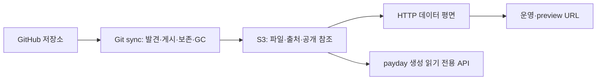

# MVP 동작과 운영

## 구성



데이터 평면은 게시된 Storage 상태만 읽는다. GitHub와 sync는 HTTP 요청 처리
경로에 없다. 각 sync는 stable source ID로 자기 배포를 관리하고 Storage에 남은
소유권·출처로 재시작 후 상태를 복원한다. 한 앱의 수명주기 소유자는 하나다.
리소스·서비스 계약은 payday로 생성하며 실제 Get/List는 Storage 구현이다.
SQL Sink·DB·분산 락·다중 객체 트랜잭션을 요구하지 않는다.

## 설정

전체 예시는 `page.yaml`이다.

```yaml
listen: ":8080"
api_listen: "127.0.0.1:50051"
base_domain: example.com
preview_style: flat
preview_alias_mode: qualified
refresh_interval: 5m
storage:
  bucket: page
  prefix: page
  region: us-east-1
  endpoint: http://127.0.0.1:19090
  path_style: true
github:
  - id: github-acme
    owner: acme
    owner_type: org
    token: ""
    repository_pattern: '^([a-z0-9][a-z0-9-]*)\.app$'
    branch: main
    manifest_path: page.yaml
    poll_interval: 1m
    gc_grace: 24h
    asset_retention: 24h
    branches: ["main", "develop", "feature/*"]
    tags: ["v*"]
    recent_commits: 10
```

- `id`는 프로세스가 바뀌어도 유지하는 소스 설정 ID다. 다른 owner가 기존 사이트
  이름을 점유하려 하면 거부한다.
- `owner_type`은 `org` 또는 `user`다. 이름 정규식의 첫 캡처를 소문자 사이트 이름으로
  사용한다. DNS label 검증과 같은 탐색 내 이름 충돌 검증을 수행한다.
- `branch`가 비어 있으면 저장소의 기본 브랜치가 운영 대상이다.
- `token`이 비어 있으면 `GITHUB_TOKEN`을 읽는다. `token: "${SOURCE_TOKEN}"`처럼
  별도 환경 변수도 사용할 수 있다. `config` 명령은 토큰을 가린다.
- `branches`와 `tags`는 짧은 Git ref 이름에 적용하는 glob이다. `*`는 전체를 선택한다.
- `recent_commits`는 운영 브랜치의 first-parent를 따라 선택할 커밋 수다. 기본은 10이고,
  커밋 시간순이나 최근 성공 배포 수를 의미하지 않는다.
- `asset_retention`은 운영 전환 뒤 이전 릴리스의 불변 자산을 제공할 기간이며 기본은
  24시간이다. `gc_grace`는 공개 참조와 자산 유예가 모두 끝난 릴리스의 삭제 대기 기간이다.
- 업로드 제한은 `max_archive_bytes`(압축/확장 아카이브, 기본 256 MiB),
  `max_file_bytes`(기본 64 MiB), `max_files`(기본 10,000)로 설정한다.

AWS 자격 증명은 SDK의 표준 환경 변수·프로파일·실행 환경 자격 증명 체인을 따른다.
실제 AWS S3에서는 버킷을 먼저 만들고 endpoint를 비운다. sync에는 해당 prefix의
객체 읽기·쓰기·삭제와 버킷 목록 권한이 필요하며 서빙 프로세스는 읽기·목록 권한으로
실행할 수 있다. 배포 제어 CLI에는 읽기·목록과 제어 객체 쓰기 권한이 필요하다.
자격 증명은 게시 메타데이터에 넣지 않는다.

## 발견·게시 계약

```text
acme/foo.app/
  page.yaml
  public/
    index.html
    assets/app.js
```

```yaml
schemaVersion: 1
publish:
  directory: public
```

대상 저장소의 배포 파일은 기본적으로 `page.yaml`이며, 호스팅 프로세스의 `--config` 파일과는 별개다.
스키마 버전은 1이고 게시 디렉터리는 레포 내 상대 경로이며 `.`도 허용한다. 배포 파일과 게시 파일은
같은 전체 SHA에서 읽는다. 알 수 없는 필드·중복 키·여러 YAML 문서·64 KiB 초과 파일은 거부한다.

기본 배포 설정은 `page.yaml`만 읽는다. 없으면 해당 커밋은 배포 대상에서 제외한다.
`manifest_path`로 다른 경로를 명시한 경우에는 그 파일만 읽으며 자동 fallback은 없다.
빌드를 실행하지 않으며 게시 디렉터리의 symlink·특수 파일·경로 탈출을 거부한다.

시작·정기 polling 때는 전체 저장소 목록을 탐색한다. 설정한 webhook은 알림에 지정된
저장소만 다시 동기화한다. 필요한 저장소·ref 목록과
그래프 조회가 성공한 결과를 기준으로 사이트를 갱신한다. 선택한 커밋을 임시 디스크에
내려받아 검증하고 파일 업로드 뒤 manifest를 작성한다. 마지막에 작은 사이트 공개
참조 객체를 교체한다. 미완성 업로드는 공개되지 않으며 실패 시 이전 성공 배포를 유지한다.

설정한 S3 prefix 아래의 구조:

```text
sites/foo/site.json
sites/foo/control.json
sources/github-acme/sites/foo/blobs/<sha256-of-body>
sources/github-acme/sites/foo/releases/<release-id>/
  upload.json
  release.json
  serving-v2.json
  index/<첫 바이트 hex>.json
```

`owner`는 수명주기 소유자이며 `origin`은 소스 종류·레포 ID·커밋·게시 디렉터리다.
Storage의 `release.json`은 서버가 작성하는 완료 manifest이며 앱의 `page.yaml`과 별개다.
내부 release ID와 Git SHA는 다른 식별자다. 파일 metadata에는 MIME·크기·SHA-256을,
사이트 객체에는 운영·preview 참조와 GC 대기 상태를 기록한다.

파일 본문은 사이트별 `blobs/` 아래에 내용의 SHA-256으로 한 번만 저장한다. 같은 사이트의
릴리스가 바뀌지 않은 파일을 공유하므로, 커밋마다 바뀐 본문만 올린다. 게시는 먼저 해시를
계산하고 같은 크기의 blob이 있으면 올리지 않는다. 올리는 동안 본문이 바뀌면 그 blob을 지우고
게시를 실패시킨다. 릴리스를 지운 GC 패스는 사이트의 남은 릴리스(완료·대기)가 참조하지 않는
blob을 지운다. 한 소스가 같은 사이트의 게시와 GC를 순서대로 하며, 그래도 다른 writer에
대비해 최근 1시간 안에 쓴 blob은 남긴다. 프로세스가 시작한 뒤 사이트마다 한 번은 릴리스
삭제가 없어도 blob을 정리한다.

`serving-v2.json`에는 파일 목록 없이 릴리스 식별 정보와 라우팅 설정만 기록한다. 각 파일의
크기·MIME·SHA-256·immutable 여부는 경로 SHA-256의 첫 바이트로 나눈 `index/` 샤드(최대
256개)에 기록한다. 샤드마다 소유자·사이트·릴리스 ID·레포 ID·생성 시각을 확인하며, 경로가
다른 샤드에 들어 있으면 거부한다. 파일이 몇 개든 릴리스 하나는 샤드 256개 이하로 기록된다.
본문과 이 메타데이터를 업로드한 뒤 완료 manifest를 기록한다. 캐시가 없는 최초 조회는
완료 manifest의 존재와 현재 descriptor 형식을 확인한다. 이전 Storage 형식(`manifest.json`·
`serving.json`·`metadata/`·`files/`)은 읽지 않는다.

사이트 변경 확인은 게시 알림과 기존 5분 background 재조회가 담당한다. 로컬 게시가
성공하면 새 요청 전에 mutable 캐시를 무효화한다. 정기 조회는 현재 사이트 메타데이터를
가져와 디스크 캐시를 갱신하고 호스트 인덱스를 교체한다. 디스크 캐시의 오래된 사이트가
게시 무효화나 정기 조회 뒤 다시 노출되지 않도록 해당 사본도 함께 무효화한다.

완료된 `serving-v2.json`과 해석한 라우팅은 소유자·사이트·릴리스 ID·사이트 게시 시각으로
재사용한다. `index/` 샤드는 릴리스 생성 시각으로 묶어 불변 캐시에 둔다. 같은 Git 커밋이 GC 후
재게시돼도 새 descriptor와 샤드를 함께 읽는다. 파일 경로 후보의 샤드만 조회하고, 선택된
본문을 blob에서 스트리밍하며 SHA-256 ETag를 유지한다.
이전 운영 자산의 lease 만료는 캐시와 무관하게 요청마다 검사한다.

메모리 캐시는 LRU이며 기본 4 MiB의 계산된 비용 상한을 둔다. 비용에는 encoded JSON과
해석한 객체의 보수적인 추정치가 포함되며, 실제 Go heap·프로세스 RSS 상한을 뜻하지 않는다.
메모리에서 밀려난 데이터는 로컬 디스크의 2차 캐시에서 다시 읽는다. 디스크 hit는 origin 재확인 없이 메모리로 올린다. 디스크 캐시는
저장소 namespace별 기본 64 MiB이며 용량 압박에 따라 오래된 항목을 제거한다. 앱 파일 수·보존 릴리스 수 전체를
메모리에 올리지 않고 활성 메타데이터만 상한 안에서 보관한다.

디스크 파일은 임시 파일과 rename으로 교체하고 저장소 namespace·키·checksum을 검사한다.
손상·누락·디스크 쓰기 실패는 origin 조회로 복구한다. origin 조회 실패는 503을 반환한다. `directory: ""`이면 디스크 캐시를 끈다.
컨테이너에서는 cache 디렉터리를 쓰기 가능한 디스크 기반 `emptyDir`로 마운트할 수 있다.
재시작 시 캐시가 사라져도 Storage에서 복구하므로 PVC가 필요하지 않다.

5분 인덱스 재조회는 릴리스 전체를 읽거나 라우팅을 미리 컴파일하지 않는다. 실패하면 이전
호스트 인덱스를 유지하고 1·2·4초 간격으로 최대 세 번 재시도한다. sync와 읽기 전용 API는
이 서빙 캐시를 우회하며, 게시 검증·GC·조회 작업 중 전체 manifest를 일시적으로 읽을 수 있다.
`gc_grace`는 background 재조회 주기와 진행 중 다운로드 시간을 충분히 넘도록 설정한다.

GitHub 이벤트로 소유 sync를 깨우려면 `run` 또는 지속 실행하는 `sync`에 별도 listener를 켠다.

```yaml
webhook_listen: ":8081"
webhook_secret: "${GITHUB_WEBHOOK_SECRET}"
```

listener는 기본적으로 꺼져 있다. `webhook_secret`을 생략하면 같은 이름의 환경 변수
`GITHUB_WEBHOOK_SECRET`을 사용하며, listener를 켤 때 비어 있으면 시작을 거부한다.
`page config`는 이 값을 가린다. `serve`와 `sync --once`는 webhook listener를 열지 않는다.

GitHub 저장소 또는 조직 webhook에 다음을 설정한다.

- URL: 외부 HTTPS reverse proxy가 webhook listener로 전달하는 `/webhooks/github`.
- Content type: `application/json`.
- Secret: 서버의 `GITHUB_WEBHOOK_SECRET`과 같은 값.
- Events: `push`, `create`, `delete`, `repository`. 생성 시 `ping`도 지원한다.

receiver는 원문 body의 `X-Hub-Signature-256` HMAC-SHA256을 확인하고 2 MiB를 넘는
body는 거부한다. 설정한 owner·저장소 이름 규칙에 맞는 이벤트는 해당 저장소만 동기화한다.
GitHub에서 그 저장소의 현재 ID·소유자·이름을 다시 확인하고 manifest·ref 정책을 적용한다.
payload의 SHA나 파일을 직접 게시하지 않으며 다른 저장소의 ref·게시 상태·GC를 조회하거나
갱신하지 않는다. 서명 검증 방식은 [GitHub 공식 안내](https://docs.github.com/en/webhooks/using-webhooks/validating-webhook-deliveries)를 따른다.

알림은 상태를 다시 읽으라는 힌트이며 같은 저장소의 중복은 합쳐 처리한다. 서로 다른 저장소의
알림과 실행 중 들어온 알림은 각각 후속 실행을 위해 남긴다. 실패 재시도도 실패한 대상만 처리한다.
GitHub 이벤트를 놓치거나 너무 커서 거부했을 때는 소스의 `poll_interval` 전체 탐색으로 복구한다.
이 주기와 서빙의 `refresh_interval`은 별개다.

같은 Catalog에서 기록한 제어 의도는 소유 sync의 제어 반영만 깨우고 GitHub 전체 탐색을
실행하지 않는다. 별도 CLI 프로세스가 쓴
`control.json`은 소유 sync의 다음 polling에서 적용한다. `sync`와 `serve`를 별도 프로세스로
운영하면 게시 알림도 공유되지 않으므로 새 사이트·preview 호스트는 다음
`refresh_interval`에 발견한다. 이미 알고 있는 호스트의 배포 전환·삭제·비활성화는 5분
background 재조회로 확인한다. 프로세스 사이 호스트 추가 알림 전달은 별도 연결이 필요하다.

외부 proxy는 webhook의 정확한 경로만 listener로 전달한다. 정적 사이트·gRPC 관리 경로는
이 webhook 경로에 포함하지 않는다. `gc_grace`는 알림을 놓쳤을 때의 서빙 재확인 주기와
조회·진행 중 다운로드 시간을 넘도록 설정한다.

## HTTP와 DNS/TLS

Host를 정확히 매칭하고 GET/HEAD, directory index, MIME, ETag/Last-Modified,
단일·multipart Range와 404를 지원한다. 한 요청은 하나의 release snapshot에 고정한다.
`Cache-Control: no-cache`로 재검증을 요구한다. 게시 알림과 `refresh_interval`에 따른
메타데이터 갱신은 [변경 알림과 재확인](#변경-알림과-재확인)을 따른다.

기존 DNS의 `*.example.com`을 HTTP 서버/LB로 연결한다. flat preview는 같은
`*.example.com` 인증서로 처리할 수 있다. nested preview는 앱별
`*.foo.example.com` DNS 설정과 해당 이름을 덮는 인증서를 준비하는 구성이 명확하다.
DNS와 TLS wildcard의 범위는 다르며 `*.example.com` 인증서는
`preview.foo.example.com`을 덮지 않는다.
[인증서 범위 참고](https://docs.aws.amazon.com/acm/latest/userguide/acm-certificate-characteristics.html)

TLS는 기존 reverse proxy나 LB에서 준비한 인증서로 종료한다. 자체 TLS·인증서 발급
자동화와 DNS 응답 서버는 포함하지 않는다. GC 유예는 metadata 재조회 지연과 긴
다운로드 시간을 충분히 넘도록 설정한다.

gRPC API는 기본 loopback에서 제공하고 reflection으로 계약을 조회한다. 생성된
Site/Deployment Get/List를 구현하며 공개 인터넷용 인증 계층과 관리 콘솔은 포함하지 않는다.

## 개발 S3와 검증 범위

compose의 [Adobe S3Mock](https://github.com/adobe/S3Mock)은 개발·테스트용 S3 API
구현이며 확인한 image digest에 고정했다. 실제 AWS IAM·장애 동작과 모든 S3 호환
제품의 보장을 검증하는 것은 아니다.

```sh
./scripts/test-s3.sh
docker compose down       # 개발 데이터 volume은 유지
```

endpoint를 지정하지 않으면 스크립트가 compose의 S3를 시작하고 준비를 기다린다.
기존 테스트 endpoint를 사용할 수도 있다.

```sh
PAGE_TEST_S3_ENDPOINT=http://s3-test-host:19090 \
PAGE_TEST_S3_BUCKET=page-storage-test \
AWS_ACCESS_KEY_ID=page-dev \
AWS_SECRET_ACCESS_KEY=page-dev-secret \
./scripts/test-s3.sh
```

Docker daemon이 원격이면 `127.0.0.1`은 daemon 호스트와 개발 셸에서 서로 다르다.
그 환경에서는 필요한 네트워크에서만 접근할 bind 주소와 실제 daemon 호스트를 지정한다.

```sh
PAGE_S3_BIND=0.0.0.0 docker compose up -d s3
PAGE_TEST_S3_ENDPOINT=http://docker-host:19090 ./scripts/test-s3.sh
```

통합 테스트는 별도 prefix를 사용하며 버킷이 없으면 생성한다. 기본 `go test ./...`는
이 endpoint 통합 검증을 건너뛰고 메모리·HTTP protocol fixture·가짜 GitHub를 통한
반복 가능한 검증을 수행한다. 실제 AWS 계정과 실제 조직 배포 검증은 별도로 기록한다.

2026-10-25에는 고정한 S3Mock 이미지를 Docker로 실행하고, 직접 실행 및 compose의
named volume 구성 모두에서 `scripts/test-s3.sh`를 통과했다. 객체 읽기·쓰기·정보 조회,
Range, 목록 pagination과 삭제 계약을 HTTP S3 API에 대해 확인했다. 이 기록에는 실제
AWS 계정이나 실제 GitHub 조직의 배포 검증이 포함되지 않는다.

`TestMVPWithS3`는 GitHub API fixture에서 실제 sync 명령을 실행해 S3에 게시하고,
별도 데이터 평면의 운영·commit preview 응답, 새 커밋 전환, 소스 실패 시 기존 서빙,
preview 공개 중단과 GC, `status` 조회까지 검증한다. 같은 S3 endpoint를 사용하는
CI와 `scripts/test-s3.sh`에 포함한다.

## 후속 범위

OCI sync, 다른 Git forge, FS/CephFS backend, 외부 redirect·proxy,
임의 revision의 요청 시 게시, 공유 blob 중복 제거, 복수 소유자, SaaS·관리 콘솔과
분산 전역 일관성은 포함하지 않는다. OCI 추가 시에는 OCI 고유의 tag/digest와 정책을
구현하고 공통 게시·Storage·서빙 경계에 연결한다.
