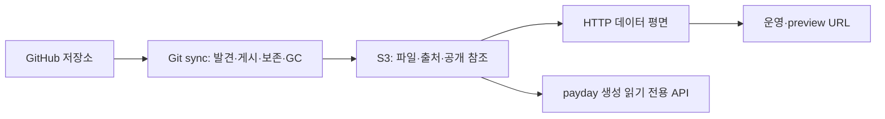

# MVP 동작과 운영

## 구성



데이터 평면은 게시된 Storage 상태만 읽는다. GitHub와 sync는 HTTP 요청 처리
경로에 없다. 각 sync는 stable source ID로 자기 배포를 관리하고 Storage에 남은
소유권·출처로 재시작 후 상태를 복원한다. 한 앱의 수명주기 소유자는 하나다.
리소스·서비스 계약은 payday로 생성하며 실제 Get/List는 Storage 구현이다.
SQL Sink·DB·분산 락·다중 객체 트랜잭션을 요구하지 않는다.

## 설정

전체 예시는 `page.yaml`이다.

```yaml
listen: ":8080"
api_listen: "127.0.0.1:50051"
base_domain: example.com
preview_style: flat
preview_alias_mode: qualified
refresh_interval: 5m
storage:
  bucket: page
  prefix: page
  region: us-east-1
  endpoint: http://127.0.0.1:19090
  path_style: true
github:
  - id: github-acme
    owner: acme
    owner_type: org
    token: ""
    repository_pattern: '^([a-z0-9][a-z0-9-]*)\.app$'
    branch: main
    manifest_path: page.yaml
    poll_interval: 1m
    gc_grace: 24h
    asset_retention: 24h
    branches: ["main", "develop", "feature/*"]
    tags: ["v*"]
    recent_commits: 10
```

- `id`는 프로세스가 바뀌어도 유지하는 소스 설정 ID다. 다른 owner가 기존 사이트
  이름을 점유하려 하면 거부한다.
- `owner_type`은 `org` 또는 `user`다. 이름 정규식의 첫 캡처를 소문자 사이트 이름으로
  사용한다. DNS label 검증과 같은 탐색 내 이름 충돌 검증을 수행한다.
- `branch`가 비어 있으면 저장소의 기본 브랜치가 운영 대상이다.
- `token`이 비어 있으면 `GITHUB_TOKEN`을 읽는다. `token: "${SOURCE_TOKEN}"`처럼
  별도 환경 변수도 사용할 수 있다. `config` 명령은 토큰을 가린다.
- `branches`와 `tags`는 짧은 Git ref 이름에 적용하는 glob이다. `*`는 전체를 선택한다.
- `recent_commits`는 운영 브랜치의 first-parent를 따라 선택할 커밋 수다. 기본은 10이고,
  커밋 시간순이나 최근 성공 배포 수를 의미하지 않는다.
- `asset_retention`은 운영 전환 뒤 이전 릴리스의 불변 자산을 제공할 기간이며 기본은
  24시간이다. `gc_grace`는 공개 참조와 자산 유예가 모두 끝난 릴리스의 삭제 대기 기간이다.
- 업로드 제한은 `max_archive_bytes`(압축/확장 아카이브, 기본 256 MiB),
  `max_file_bytes`(기본 64 MiB), `max_files`(기본 10,000)로 설정한다.

AWS 자격 증명은 SDK의 표준 환경 변수·프로파일·실행 환경 자격 증명 체인을 따른다.
실제 AWS S3에서는 버킷을 먼저 만들고 endpoint를 비운다. sync에는 해당 prefix의
객체 읽기·쓰기·삭제와 버킷 목록 권한이 필요하며 서빙 프로세스는 읽기·목록 권한으로
실행할 수 있다. 배포 제어 CLI에는 읽기·목록과 제어 객체 쓰기 권한이 필요하다.
자격 증명은 게시 메타데이터에 넣지 않는다.

## 발견·게시 계약

```text
acme/foo.app/
  page.yaml
  public/
    index.html
    assets/app.js
```

```yaml
schemaVersion: 1
publish:
  directory: public
```

대상 저장소의 배포 파일은 기본적으로 `page.yaml`이며, 호스팅 프로세스의 `--config` 파일과는 별개다.
스키마 버전은 1이고 게시 디렉터리는 레포 내 상대 경로이며 `.`도 허용한다. 배포 파일과 게시 파일은
같은 전체 SHA에서 읽는다. 알 수 없는 필드·중복 키·여러 YAML 문서·64 KiB 초과 파일은 거부한다.

기본 경로에서 `page.yaml`이 404이면 과거 커밋의 preview를 유지하기 위해 이전 `manifest.json`을 읽는다.
`page.yaml`이 존재하지만 잘못됐으면 이전 파일로 우회하지 않는다. `manifest_path`로 다른 경로를 지정하면
그 파일만 읽는다. 새 배포 파일은 `page.yaml`을 사용한다.
빌드를 실행하지 않으며 게시 디렉터리의 symlink·특수 파일·경로 탈출을 거부한다.

시작·정기 polling 때는 전체 저장소 목록을 탐색한다. 설정한 webhook은 알림에 지정된
저장소만 다시 동기화한다. 필요한 저장소·ref 목록과
그래프 조회가 성공한 결과를 기준으로 사이트를 갱신한다. 선택한 커밋을 임시 디스크에
내려받아 검증하고 파일 업로드 뒤 manifest를 작성한다. 마지막에 작은 사이트 공개
참조 객체를 교체한다. 미완성 업로드는 공개되지 않으며 실패 시 이전 성공 배포를 유지한다.

설정한 S3 prefix 아래의 구조:

```text
sites/foo/site.json
sites/foo/control.json
sources/github-acme/sites/foo/releases/<release-id>/
  upload.json
  manifest.json
  files/index.html
  files/assets/app.js
```

`owner`는 수명주기 소유자이며 `origin`은 소스 종류·레포 ID·커밋·게시 디렉터리다.
Storage의 `manifest.json`은 서버가 작성하는 릴리스 메타데이터이며 앱의 `page.yaml`과 별개다.
내부 release ID와 Git SHA는 다른 식별자다. 파일 metadata에는 MIME·크기·SHA-256을,
사이트 객체에는 운영·preview 참조와 GC 대기 상태를 기록한다.

## pages.json 라우팅

게시 디렉터리 루트의 `pages.json`은 선택적 라우팅 설정이며 저장소의 `page.yaml` 배포 파일과 별개다.
설정과 대상 파일 목록을 게시 전에 검증하며 완성된 릴리스에 고정한다.
알 수 없는 필드·지원하지 않는 버전·잘못된 대상·64 KiB를 넘는 설정은 게시를 거부한다.
실패한 배포가 기존 운영 배포를 바꾸지 않는다.

```text
public/
  pages.json
  index.html
  about.html
  404.html
  guides/start.html
  assets/app.a1b2.js
```

[examples/pages.json](../examples/pages.json)은 위 파일 목록에 적용할 수 있는 예시다.
핵심 필드는 다음과 같다.

| 필드 | 동작 |
| --- | --- |
| `schemaVersion` | 현재 `1` |
| `routing.cleanUrls` | `/about`을 `about.html`로 조회. 기본 `false` |
| `routing.index` | 디렉터리 index 파일명. 기본 `index.html` |
| `routing.trailingSlash` | `preserve`(기본), `append`, `remove`. 파일 자체의 URL은 우선하며 index·clean URL에 적용 |
| `routing.routes` | 선언 순서대로 첫 일치 규칙의 `rewrite` 또는 `redirect` 수행 |
| `routing.fallback` | 파일이 없는 HTML 탐색에 `rewrite` 적용. `exclude` 경로는 제외 |
| `routing.errorPages.404` | 파일이 없는 요청에 지정 문서를 HTTP 404로 응답 |
| `headers` | 원래 요청 경로에 일치하는 `from`의 `set` 헤더 적용. 뒤 규칙이 앞 값을 덮어씀 |
| `assets.immutable` | 이전 운영 릴리스 자산 유예 서빙에 포함할 경로 패턴 |

경로 패턴은 `/`로 시작하며 `:name`은 한 segment, 마지막 segment인 `*`는 나머지
경로를 캡처한다. rewrite·redirect 대상에 같은 `:name` 또는 `*`를 사용할 수 있다.
예를 들어 `/docs/:page` → `/guides/:page.html`은 `/docs/start`를 `guides/start.html`로
조회한다. rewrite는 다시 규칙 목록을 순회하지 않는 한 번의 파일 조회다. 동적 대상은
실제 파일과 일치하는 대상이 하나 이상 있어야 하며, 요청 시 대상 파일이 없으면 404다.

redirect는 사이트 내 절대 경로만 허용한다. 기본 상태는 302이며 301·302·307·308을
지원한다. 외부 URL·query가 포함된 대상·경로 탈출·redirect 순환은 거부한다.
redirect의 출력 패턴이 다른 redirect의 입력과 겹치면 의존 관계로 검사하므로,
동적 캡처 값에 따라 종료할 수 있는 설정도 순환 가능성이 있으면 보수적으로 거부한다.
redirect 응답은 원래 요청의 query를 유지한다. 기본 `preserve`도 디렉터리 index를
찾은 `/guide`를 `/guide/`로 정규화한다.

SPA fallback은 HTML 탐색 요청에만 적용한다. Accept와 Sec-Fetch-Dest를 확인하며
누락 시 확장자가 없거나 HTML인 경로를 탐색으로 취급한다. `/assets/*` 같은 정적 자산
경로를 `exclude`에 넣어 없는 JS·CSS에 HTML이 응답되지 않도록 설정한다. custom 404는
HEAD에서 본문을 생략하고 Range·조건부 요청에도 404 상태를 유지한다.

응답 헤더는 CSP·Cache-Control 등을 설정할 수 있다. Content-Type·Content-Length·
ETag·Location·Set-Cookie·연결 관련 헤더처럼 서버가 관리하는 값과 CR/LF는 거부한다.
`X-Content-Type-Options`는 `nosniff`만 허용한다. 기본 파일 응답은
`Cache-Control: no-cache`이며 불변 자산의 긴 캐시는 직접 설정한다. 헤더 규칙은
404·redirect에도 적용되므로 긴 캐시를 설정할 때는 해당 경로의 오류 응답도 고려한다.

배포 전 로컬에서 동일한 검증기와 resolver를 실행한다. Storage 설정이나 자격 증명은
필요 없다. `--navigation=false`는 위치 인자 앞에 쓴다.

```sh
go run ./cmd/page routes validate ./public
go run ./cmd/page routes test ./public /docs/start
go run ./cmd/page routes test --navigation=false ./public /assets/missing.js
```

`test`는 최종 파일 `Path`, HTTP `Status`, `Redirect`, `Headers`, 처리 `Action`을
JSON으로 출력한다. pages.json이 없을 때도 기본 정적 파일 규칙을 검사할 수 있다.

## 배포 제어

운영 배포를 변경하는 명령은 Storage의 `control.json`에 의도를 저장한다. Git sync가
이를 읽어 자기 소유 사이트에 반영하고 `site.json`을 교체한다. 소스 정책과 GC를
한 소유자에서 직렬 처리하므로 별도 CLI가 삭제 중인 릴리스를 공개하지 않는다.
각 소스·사이트에는 활성 writer를 하나만 실행한다.

```sh
go run ./cmd/page releases foo
go run ./cmd/page promote foo RELEASE --wait 90s
go run ./cmd/page rollback foo --wait 90s
go run ./cmd/page rollback foo RELEASE
go run ./cmd/page pin foo
go run ./cmd/page pause foo
go run ./cmd/page resume foo
go run ./cmd/page remove foo
```

| 명령 | 저장하는 의도 |
| --- | --- |
| `releases SITE` | 보존 중인 릴리스의 ID·SHA·운영 여부·자산 만료 시각 조회 |
| `promote SITE RELEASE` | 완성된 같은 사이트·레포의 릴리스를 운영으로 지정하고 고정 |
| `rollback SITE [RELEASE]` | 지정 릴리스, 생략하면 운영 이력 중 아직 보존된 직전 릴리스로 고정 |
| `pin SITE [RELEASE]` | 지정 릴리스, 생략하면 현재 운영 배포 고정 |
| `pause SITE` | 현재 운영 배포를 유지하고 자동 전환 일시 중지 |
| `resume SITE` | 고정·일시 중지·철거를 해제하고 소스 정책에 따른 자동 전환 재개 |
| `remove SITE` | 운영·preview 공개를 중단하고 재발견되어도 다시 게시하지 않도록 유지 |

`RELEASE`는 Git SHA가 아닌 `releases` 출력의 내부 ID다. 고정과 pause 중에도
선택한 preview는 갱신한다. promote·rollback·pin은 resume 전까지 유지된다. 이력은
최근 운영 릴리스 ID를 최대 32개 기록하며, 이력만으로 GC를 막지는 않는다.
이미 수집된 릴리스로는 rollback할 수 없다.

명령은 기본적으로 요청 저장 직후 JSON을 출력한다. `controlApplied: false`이면
소유 sync가 아직 반영하지 않은 상태다. `--wait 90s`는 적용 확인까지 기다리며
시간이 지나도 저장한 요청은 유지된다. 비활성 sync의 요청은 대기 상태로 남는다.
제어 의도와 게시 상태는 `status`의 `control`에서도 볼 수 있다. 데이터 평면은 소유 sync가
반영한 사이트 메타데이터를 읽는다. 같은 `run` 프로세스에서는 사이트 게시 완료 알림으로
서빙을 갱신한다. 별도 프로세스의
변경이나 놓친 알림은 `refresh_interval`에 따라 재확인한다.

`--config`, `--source`, `--wait`는 명령의 위치 인자 앞뒤에 둘 수 있다. `--source`는
사이트 소유 ID를 검증하며 생략하면 기존 소유자를 사용한다. 제어 API는 별도 인증
계층을 추가하지 않으므로 이 CLI의 Storage 쓰기 자격 증명을 운영 권한으로 관리한다.

소유 sync는 새로운 제어 의도를 GitHub 조회 전에 반영할 수 있다. GitHub 장애 중에도
보존된 릴리스의 고정·일시 중지·공개 중단 요청을 처리한다. resume 뒤 최신 소스
배포는 다음 성공한 GitHub 조회에 따라 결정된다. 대상이 요청 저장과 반영 사이에
사라지면 기존 공개 상태를 유지하고 요청은 미적용 상태로 남는다. `status`에
`requested release is no longer retained`가 표시되면 보존된 대상으로 다시 요청한다.

## preview와 보존

branch/tag 별칭은 해당 ref의 최신 성공 배포를 가리킨다. 새 배포가 실패하면 이전
성공 배포를 유지한다. commit 별칭은 전체 SHA에 고정되며 같은 snapshot은 공유한다.
기본 `preview_alias_mode: qualified`는 `b-`, `t-`, `c-` 종류 접두사, 안전한 slug와
해시로 별칭을 구성한다. 원래 ref와 전체 SHA는 metadata에 남는다. 다음 명령은 Storage만 읽어 사이트·운영 URL과
preview별 ref·SHA·정확한 URL을 JSON으로 출력한다. HTTP/gRPC 서버가 실행 중일
필요는 없다.

```sh
go run ./cmd/page status --config examples/github.yaml
```

출력 URL은 외부 TLS 종료를 전제한 HTTPS 주소다. 로컬 HTTP 개발 환경에서는
출력된 hostname을 `Host` 헤더에 넣어 요청한다.

```sh
curl -H 'Host: foo.example.com' http://127.0.0.1:8080/
```

flat URL은 `<별칭>--foo.example.com`, nested URL은 `<별칭>.foo.example.com`이다.
기본 모드는 길거나 변환 결과가 같은 이름을 해시가 포함된 길이 제한 규칙으로 구별한다.

서버 설정을 `preview_alias_mode: tag-first`로 바꾸면 branch/tag는 ref 종류와 해시를
생략한다. `refs/heads/feat/test`는 `feat-test--foo.example.com`,
`refs/tags/v0.1.0`은 `v0-1-0--foo.example.com`으로 제공한다. ref 이름을 소문자로
바꾸고 구두점은 하이픈 하나로 합친다. 같은 주소에 게시된 tag가 있으면 tag를
선택하고, 없으면 branch를 선택한다. tag가 보존 정책에서 제거되면 다음 서버
갱신 때 같은 주소가 branch로 전환된다. 원격 GitHub의 ref를 요청마다 조회하지 않는다.
소스 조회가 실패하면 마지막으로 성공한 게시 상태를 유지한다.

같은 종류의 여러 ref가 같은 주소로 변환되면 그 짧은 주소는 제공하지 않는다.
tag끼리 모호한 경우 branch로 대신 제공하지 않는다. DNS 길이 제한을 넘거나 다른
사이트의 운영 주소·기존 별칭 주소와 충돌해도 짧은 주소를 제공하지 않는다.
`status`는 선택한 짧은 URL과 commit URL을 `previews`에 출력하고, 짧은 주소를 쓰지
못한 ref는 이유와 기존 URL을 `previewProblems`에 출력한다. 기존 접두사·해시가
있는 branch/tag URL은 계속 동작하며 commit URL은 바뀌지 않는다. 이 설정은 URL
선택만 바꾸며 ref 보존 정책과 Storage metadata 형식은 바꾸지 않는다.

현재 운영 배포, 선택 branch/tag의 최신 성공 배포와 최근 N개 선택 커밋의 배포를
보존한다. branch를 유지한다고 모든 과거 배포를 영구 보존하지 않는다. 정책에서
제외된 preview는 공개 참조에서 제거하므로 파일이 남아 있어도 서빙하지 않는다.
미게시·만료 URL 요청은 GitHub 다운로드를 유발하지 않는다.

참조 제거 시각을 Storage에 기록하고 `gc_grace` 이후 자기 소유이며 현재 운영·다른
별칭·만료 전 자산 유예에서 참조하지 않는 배포만 삭제한다. 부분 삭제 실패와 재시작 뒤에는 다음 성공한
동기화에서 이어서 처리한다. 조회 실패·권한 오류·불완전한 pagination을 빈 보존 집합으로
취급하지 않는다.

저장소 삭제·이름 변경·소스 설정 제거는 기존 게시물을 자동 삭제하지 않는다.
`remove`로 명시적으로 공개를 중단한 사이트는 tombstone을 남겨 재발견에 따른 복원을
막는다. 소유 sync는 GitHub가 응답하지 않아도 그 사이트의 보존·GC를 진행할 수 있다.
자산 유예도 제거되며 `gc_grace`가 지난 자기 릴리스를 수집한다. 재사용하려면
`resume`하고 sync를 실행한다. 소스 설정 자체를 제거하면 해당 소유 sync의 GC도 멈춘다.

## 배포 전환 시 자산

운영 HTML을 교체해도 이미 열린 브라우저는 이전 HTML이 가리키는 JS·CSS·이미지를
추가 요청할 수 있다. 전환 시 이전 **운영** 릴리스에 자산 lease를 남겨 이 요청을
처리한다. 기간은 소스의 `asset_retention`이며 서버는 요청마다 만료를 확인한다.

이전 릴리스의 `pages.json`에서 `assets.immutable`로 선언한 실제 파일만 대상이다.
HTML·XHTML·pages.json은 확장자와 MIME을 검사해 제외한다. 운영 호스트에서 현재
파일을 찾지 못했을 때, SPA fallback 또는 404 대신 만료 전 이전 자산을 조회한다.
명시적인 rewrite·redirect가 있으면 그 규칙을 우선한다. preview 호스트에는 이전
운영 자산을 추가하지 않으며 선택되지 않은 preview 릴리스를 되살리지 않는다.

`/assets/app.a1b2.js`처럼 콘텐츠 해시를 파일명에 포함한다. 보호 기간 동안 같은 URL에
다른 바이트나 MIME을 게시하거나, 그 URL을 redirect하거나, 없는 대상 또는 다른
콘텐츠로 rewrite하는 전환은 거부한다. 고정·rollback도 같은 검증을 통과해야 한다.
`assets.immutable`을 선언하지 않은 이전 일반 파일·HTML은 새 운영 릴리스로 전환한
뒤 서빙하지 않는다.

자산 lease가 끝나면 서빙을 중단하고 공개 참조가 없는 릴리스를 GC 대상으로 삼는다.
객체가 아직 Storage에 남아 있어도 만료된 자산을 응답하지 않는다. `gc_grace`는
서빙 metadata 재조회와 진행 중 다운로드를 위한 별도의 삭제 유예다.

## 변경 알림과 재확인

`refresh_interval`의 기본값은 5분이다. 서빙 프로세스는 시작 시 즉시 전체 게시 상태를 읽고,
같은 프로세스에서 `site.json` 저장이 성공하면 알림으로 다시 확인한다. 5분 주기 조회는
알림 유실이나 다른 프로세스의 게시를 발견하는 복구 경로다.

불변 release manifest와 컴파일한 라우팅 엔진은 `(owner, site, id)`로 캐시한다.
`site.json`은 목록의 ETag가 바뀐 것만 다시 읽고 GET 본문과 해당 응답의 ETag를 함께 보관한다.
ETag가 없는 Storage에서는 GET으로 확인한다. 객체가 변경되지 않은 refresh의 Storage 요청은
목록 페이지 수만큼의 LIST뿐이다. sync는 ref가 같아도 게시 점검 시각을 저장할 수 있으므로
그때는 해당 `site.json`을 다시 읽는다.

새 라우팅과 캐시는 전체 조회·검증 성공 후 함께 교체한다. 실패하면 이전 snapshot을 유지하고
1·2·4초 간격으로 최대 세 번 빠르게 재시도한 뒤 새 알림이나 정기 재확인을 기다린다.
현재 운영·preview·만료 전 이전 자산에서 참조하지 않는 release
캐시는 제거하며, 자산 만료는 여전히 HTTP 요청마다 확인한다.

GitHub 이벤트로 소유 sync를 깨우려면 `run` 또는 지속 실행하는 `sync`에 별도 listener를 켠다.

```yaml
webhook_listen: ":8081"
webhook_secret: "${GITHUB_WEBHOOK_SECRET}"
```

listener는 기본적으로 꺼져 있다. `webhook_secret`을 생략하면 같은 이름의 환경 변수
`GITHUB_WEBHOOK_SECRET`을 사용하며, listener를 켤 때 비어 있으면 시작을 거부한다.
`page config`는 이 값을 가린다. `serve`와 `sync --once`는 webhook listener를 열지 않는다.

GitHub 저장소 또는 조직 webhook에 다음을 설정한다.

- URL: 외부 HTTPS reverse proxy가 webhook listener로 전달하는 `/webhooks/github`.
- Content type: `application/json`.
- Secret: 서버의 `GITHUB_WEBHOOK_SECRET`과 같은 값.
- Events: `push`, `create`, `delete`, `repository`. 생성 시 `ping`도 지원한다.

receiver는 원문 body의 `X-Hub-Signature-256` HMAC-SHA256을 확인하고 2 MiB를 넘는
body는 거부한다. 설정한 owner·저장소 이름 규칙에 맞는 이벤트는 해당 저장소만 동기화한다.
GitHub에서 그 저장소의 현재 ID·소유자·이름을 다시 확인하고 manifest·ref 정책을 적용한다.
payload의 SHA나 파일을 직접 게시하지 않으며 다른 저장소의 ref·게시 상태·GC를 조회하거나
갱신하지 않는다. 서명 검증 방식은 [GitHub 공식 안내](https://docs.github.com/en/webhooks/using-webhooks/validating-webhook-deliveries)를 따른다.

알림은 상태를 다시 읽으라는 힌트이며 같은 저장소의 중복은 합쳐 처리한다. 서로 다른 저장소의
알림과 실행 중 들어온 알림은 각각 후속 실행을 위해 남긴다. 실패 재시도도 실패한 대상만 처리한다.
GitHub 이벤트를 놓치거나 너무 커서 거부했을 때는 소스의 `poll_interval` 전체 탐색으로 복구한다.
이 주기와 서빙의 `refresh_interval`은 별개다.

같은 Catalog에서 기록한 제어 의도는 소유 sync의 제어 반영만 깨우고 GitHub 전체 탐색을
실행하지 않는다. 별도 CLI 프로세스가 쓴
`control.json`은 소유 sync의 다음 polling에서 적용한다. `sync`와 `serve`를 별도 프로세스로
운영하면 게시 알림도 공유되지 않으므로 서빙 반영은 다음 `refresh_interval`에 이루어진다.
프로세스 사이 알림 전달은 별도 연결이 필요하다.

외부 proxy는 webhook의 정확한 경로만 listener로 전달한다. 정적 사이트·gRPC 관리 경로는
이 webhook 경로에 포함하지 않는다. `gc_grace`는 알림을 놓쳤을 때의 서빙 재확인 주기와
조회·진행 중 다운로드 시간을 넘도록 설정한다.

## HTTP와 DNS/TLS

Host를 정확히 매칭하고 GET/HEAD, directory index, MIME, ETag/Last-Modified,
단일·multipart Range와 404를 지원한다. 한 요청은 하나의 release snapshot에 고정한다.
`Cache-Control: no-cache`로 재검증을 요구한다. 게시 알림과 `refresh_interval`에 따른
메타데이터 갱신은 [변경 알림과 재확인](#변경-알림과-재확인)을 따른다.

기존 DNS의 `*.example.com`을 HTTP 서버/LB로 연결한다. flat preview는 같은
`*.example.com` 인증서로 처리할 수 있다. nested preview는 앱별
`*.foo.example.com` DNS 설정과 해당 이름을 덮는 인증서를 준비하는 구성이 명확하다.
DNS와 TLS wildcard의 범위는 다르며 `*.example.com` 인증서는
`preview.foo.example.com`을 덮지 않는다.
[인증서 범위 참고](https://docs.aws.amazon.com/acm/latest/userguide/acm-certificate-characteristics.html)

TLS는 기존 reverse proxy나 LB에서 준비한 인증서로 종료한다. 자체 TLS·인증서 발급
자동화와 DNS 응답 서버는 포함하지 않는다. GC 유예는 metadata 재조회 지연과 긴
다운로드 시간을 충분히 넘도록 설정한다.

gRPC API는 기본 loopback에서 제공하고 reflection으로 계약을 조회한다. 생성된
Site/Deployment Get/List를 구현하며 공개 인터넷용 인증 계층과 관리 콘솔은 포함하지 않는다.

## 개발 S3와 검증 범위

compose의 [Adobe S3Mock](https://github.com/adobe/S3Mock)은 개발·테스트용 S3 API
구현이며 확인한 image digest에 고정했다. 실제 AWS IAM·장애 동작과 모든 S3 호환
제품의 보장을 검증하는 것은 아니다.

```sh
./scripts/test-s3.sh
docker compose down       # 개발 데이터 volume은 유지
```

endpoint를 지정하지 않으면 스크립트가 compose의 S3를 시작하고 준비를 기다린다.
기존 테스트 endpoint를 사용할 수도 있다.

```sh
PAGE_TEST_S3_ENDPOINT=http://s3-test-host:19090 \
PAGE_TEST_S3_BUCKET=page-storage-test \
AWS_ACCESS_KEY_ID=page-dev \
AWS_SECRET_ACCESS_KEY=page-dev-secret \
./scripts/test-s3.sh
```

Docker daemon이 원격이면 `127.0.0.1`은 daemon 호스트와 개발 셸에서 서로 다르다.
그 환경에서는 필요한 네트워크에서만 접근할 bind 주소와 실제 daemon 호스트를 지정한다.

```sh
PAGE_S3_BIND=0.0.0.0 docker compose up -d s3
PAGE_TEST_S3_ENDPOINT=http://docker-host:19090 ./scripts/test-s3.sh
```

통합 테스트는 별도 prefix를 사용하며 버킷이 없으면 생성한다. 기본 `go test ./...`는
이 endpoint 통합 검증을 건너뛰고 메모리·HTTP protocol fixture·가짜 GitHub를 통한
반복 가능한 검증을 수행한다. 실제 AWS 계정과 실제 조직 배포 검증은 별도로 기록한다.

2026-10-25에는 고정한 S3Mock 이미지를 Docker로 실행하고, 직접 실행 및 compose의
named volume 구성 모두에서 `scripts/test-s3.sh`를 통과했다. 객체 읽기·쓰기·정보 조회,
Range, 목록 pagination과 삭제 계약을 HTTP S3 API에 대해 확인했다. 이 기록에는 실제
AWS 계정이나 실제 GitHub 조직의 배포 검증이 포함되지 않는다.

`TestMVPWithS3`는 GitHub API fixture에서 실제 sync 명령을 실행해 S3에 게시하고,
별도 데이터 평면의 운영·commit preview 응답, 새 커밋 전환, 소스 실패 시 기존 서빙,
preview 공개 중단과 GC, `status` 조회까지 검증한다. 같은 S3 endpoint를 사용하는
CI와 `scripts/test-s3.sh`에 포함한다.

## 후속 범위

OCI sync, 다른 Git forge, FS/CephFS backend, 외부 redirect·proxy,
임의 revision의 요청 시 게시, 공유 blob 중복 제거, 복수 소유자, SaaS·관리 콘솔과
분산 전역 일관성은 포함하지 않는다. OCI 추가 시에는 OCI 고유의 tag/digest와 정책을
구현하고 공통 게시·Storage·서빙 경계에 연결한다.
