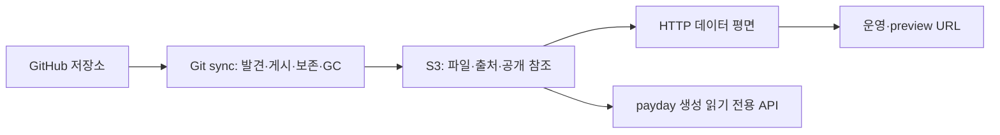

# MVP 동작과 운영

## 구성



데이터 평면은 게시된 Storage 상태만 읽는다. GitHub와 sync는 HTTP 요청 처리
경로에 없다. 각 sync는 stable source ID로 자기 배포를 관리하고 Storage에 남은
소유권·출처로 재시작 후 상태를 복원한다. 한 앱의 수명주기 소유자는 하나다.
리소스·서비스 계약은 payday로 생성하며 실제 Get/List는 Storage 구현이다.
SQL Sink·DB·분산 락·다중 객체 트랜잭션을 요구하지 않는다.

## 설정

전체 예시는 `page.yaml`이다.

```yaml
listen: ":8080"
api_listen: "127.0.0.1:50051"
base_domain: example.com
preview_style: flat
refresh_interval: 5s
storage:
  bucket: page
  prefix: page
  region: us-east-1
  endpoint: http://127.0.0.1:19090
  path_style: true
github:
  - id: github-acme
    owner: acme
    owner_type: org
    token: ""
    repository_pattern: '^([a-z0-9][a-z0-9-]*)\.app$'
    branch: main
    manifest_path: manifest.json
    poll_interval: 1m
    gc_grace: 24h
    branches: ["main", "develop", "feature/*"]
    tags: ["v*"]
    recent_commits: 10
```

- `id`는 프로세스가 바뀌어도 유지하는 소스 설정 ID다. 다른 owner가 기존 사이트
  이름을 점유하려 하면 거부한다.
- `owner_type`은 `org` 또는 `user`다. 이름 정규식의 첫 캡처를 소문자 사이트 이름으로
  사용한다. DNS label 검증과 같은 탐색 내 이름 충돌 검증을 수행한다.
- `branch`가 비어 있으면 저장소의 기본 브랜치가 운영 대상이다.
- `token`이 비어 있으면 `GITHUB_TOKEN`을 읽는다. `token: "${SOURCE_TOKEN}"`처럼
  별도 환경 변수도 사용할 수 있다. `config` 명령은 토큰을 가린다.
- `branches`와 `tags`는 짧은 Git ref 이름에 적용하는 glob이다. `*`는 전체를 선택한다.
- `recent_commits`는 운영 브랜치의 first-parent를 따라 선택할 커밋 수다. 기본은 10이고,
  커밋 시간순이나 최근 성공 배포 수를 의미하지 않는다.
- 업로드 제한은 `max_archive_bytes`(압축/확장 아카이브, 기본 256 MiB),
  `max_file_bytes`(기본 64 MiB), `max_files`(기본 10,000)로 설정한다.

AWS 자격 증명은 SDK의 표준 환경 변수·프로파일·실행 환경 자격 증명 체인을 따른다.
실제 AWS S3에서는 버킷을 먼저 만들고 endpoint를 비운다. sync에는 해당 prefix의
객체 읽기·쓰기·삭제와 버킷 목록 권한이 필요하며 서빙 프로세스는 읽기·목록 권한으로
실행할 수 있다. 자격 증명은 게시 메타데이터에 넣지 않는다.

## 발견·게시 계약

```text
acme/foo.app/
  manifest.json
  public/
    index.html
    assets/app.js
```

```json
{"schemaVersion":1,"publish":{"directory":"public"}}
```

manifest의 파일명은 설정 가능하며 스키마 버전은 1이다. 게시 디렉터리는 레포 내
상대 경로이고 `.`도 허용한다. manifest와 파일은 같은 전체 SHA에서 읽는다.
빌드를 실행하지 않으며 게시 디렉터리의 symlink·특수 파일·경로 탈출을 거부한다.

시작 시 전체 목록을 탐색하고 polling으로 반복한다. 필요한 저장소·ref 목록과
그래프 조회가 성공한 결과를 기준으로 사이트를 갱신한다. 선택한 커밋을 임시 디스크에
내려받아 검증하고 파일 업로드 뒤 manifest를 작성한다. 마지막에 작은 사이트 공개
참조 객체를 교체한다. 미완성 업로드는 공개되지 않으며 실패 시 이전 성공 배포를 유지한다.

설정한 S3 prefix 아래의 구조:

```text
sites/foo/site.json
sources/github-acme/sites/foo/releases/<release-id>/
  upload.json
  manifest.json
  files/index.html
  files/assets/app.js
```

`owner`는 수명주기 소유자이며 `origin`은 소스 종류·레포 ID·커밋·게시 디렉터리다.
내부 release ID와 Git SHA는 다른 식별자다. 파일 metadata에는 MIME·크기·SHA-256을,
사이트 객체에는 운영·preview 참조와 GC 대기 상태를 기록한다.

## preview와 보존

branch/tag 별칭은 해당 ref의 최신 성공 배포를 가리킨다. 새 배포가 실패하면 이전
성공 배포를 유지한다. commit 별칭은 전체 SHA에 고정되며 같은 snapshot은 공유한다.
별칭은 `b-`, `t-`, `c-` 종류 접두사, 안전한 slug와 해시로 구성한다. 원래 ref와
전체 SHA는 metadata에 남는다. 다음 명령은 Storage만 읽어 사이트·운영 URL과
preview별 ref·SHA·정확한 URL을 JSON으로 출력한다. HTTP/gRPC 서버가 실행 중일
필요는 없다.

```sh
go run ./cmd/page status --config examples/github.yaml
```

출력 URL은 외부 TLS 종료를 전제한 HTTPS 주소다. 로컬 HTTP 개발 환경에서는
출력된 hostname을 `Host` 헤더에 넣어 요청한다.

```sh
curl -H 'Host: foo.example.com' http://127.0.0.1:8080/
```

flat URL은 `<별칭>--foo.example.com`, nested URL은 `<별칭>.foo.example.com`이다.
길거나 변환 결과가 같은 이름은 해시를 포함하는 길이 제한 규칙으로 구별한다.

현재 운영 배포, 선택 branch/tag의 최신 성공 배포와 최근 N개 선택 커밋의 배포를
보존한다. branch를 유지한다고 모든 과거 배포를 영구 보존하지 않는다. 정책에서
제외된 preview는 공개 참조에서 제거하므로 파일이 남아 있어도 서빙하지 않는다.
미게시·만료 URL 요청은 GitHub 다운로드를 유발하지 않는다.

참조 제거 시각을 Storage에 기록하고 `gc_grace` 이후 자기 소유이며 현재 운영·다른
별칭에서 참조하지 않는 배포만 삭제한다. 부분 삭제 실패와 재시작 뒤에는 다음 성공한
동기화에서 이어서 처리한다. 조회 실패·권한 오류·불완전한 pagination을 빈 보존 집합으로
취급하지 않는다.

저장소 삭제·이름 변경·소스 설정 제거는 기존 게시물을 자동 삭제하지 않는다.
명시적 전체 철거는 소유자를 확인하고 사이트 공개 참조를 제거한 뒤, 서빙 캐시와
진행 중 요청의 유예를 두고 소유 prefix를 정리하는 Storage 운영 작업이다.
별도의 철거 CLI는 없다.

## HTTP와 DNS/TLS

Host를 정확히 매칭하고 GET/HEAD, directory index, MIME, ETag/Last-Modified,
단일·multipart Range와 404를 지원한다. 한 요청은 하나의 release snapshot에 고정한다.
`Cache-Control: no-cache`로 재검증을 요구하며 metadata는 `refresh_interval`마다
다시 읽는다. 조회 실패 시 마지막으로 완전히 읽은 라우팅 snapshot을 유지한다.

기존 DNS의 `*.example.com`을 HTTP 서버/LB로 연결한다. flat preview는 같은
`*.example.com` 인증서로 처리할 수 있다. nested preview는 앱별
`*.foo.example.com` DNS 설정과 해당 이름을 덮는 인증서를 준비하는 구성이 명확하다.
DNS와 TLS wildcard의 범위는 다르며 `*.example.com` 인증서는
`preview.foo.example.com`을 덮지 않는다.
[인증서 범위 참고](https://docs.aws.amazon.com/acm/latest/userguide/acm-certificate-characteristics.html)

TLS는 기존 reverse proxy나 LB에서 준비한 인증서로 종료한다. 자체 TLS·인증서 발급
자동화와 DNS 응답 서버는 포함하지 않는다. GC 유예는 metadata 재조회 지연과 긴
다운로드 시간을 충분히 넘도록 설정한다.

gRPC API는 기본 loopback에서 제공하고 reflection으로 계약을 조회한다. 생성된
Site/Deployment Get/List를 구현하며 공개 인터넷용 인증 계층과 관리 콘솔은 포함하지 않는다.

## 개발 S3와 검증 범위

compose의 [Adobe S3Mock](https://github.com/adobe/S3Mock)은 개발·테스트용 S3 API
구현이며 확인한 image digest에 고정했다. 실제 AWS IAM·장애 동작과 모든 S3 호환
제품의 보장을 검증하는 것은 아니다.

```sh
./scripts/test-s3.sh
docker compose down       # 개발 데이터 volume은 유지
```

endpoint를 지정하지 않으면 스크립트가 compose의 S3를 시작하고 준비를 기다린다.
기존 테스트 endpoint를 사용할 수도 있다.

```sh
PAGE_TEST_S3_ENDPOINT=http://s3-test-host:19090 \
PAGE_TEST_S3_BUCKET=page-storage-test \
AWS_ACCESS_KEY_ID=page-dev \
AWS_SECRET_ACCESS_KEY=page-dev-secret \
./scripts/test-s3.sh
```

Docker daemon이 원격이면 `127.0.0.1`은 daemon 호스트와 개발 셸에서 서로 다르다.
그 환경에서는 필요한 네트워크에서만 접근할 bind 주소와 실제 daemon 호스트를 지정한다.

```sh
PAGE_S3_BIND=0.0.0.0 docker compose up -d s3
PAGE_TEST_S3_ENDPOINT=http://docker-host:19090 ./scripts/test-s3.sh
```

통합 테스트는 별도 prefix를 사용하며 버킷이 없으면 생성한다. 기본 `go test ./...`는
이 endpoint 통합 검증을 건너뛰고 메모리·HTTP protocol fixture·가짜 GitHub를 통한
반복 가능한 검증을 수행한다. 실제 AWS 계정과 실제 조직 배포 검증은 별도로 기록한다.

2026-10-25에는 고정한 S3Mock 이미지를 Docker로 실행하고, 직접 실행 및 compose의
named volume 구성 모두에서 `scripts/test-s3.sh`를 통과했다. 객체 읽기·쓰기·정보 조회,
Range, 목록 pagination과 삭제 계약을 HTTP S3 API에 대해 확인했다. 이 기록에는 실제
AWS 계정이나 실제 GitHub 조직의 배포 검증이 포함되지 않는다.

`TestMVPWithS3`는 GitHub API fixture에서 실제 sync 명령을 실행해 S3에 게시하고,
별도 데이터 평면의 운영·commit preview 응답, 새 커밋 전환, 소스 실패 시 기존 서빙,
preview 공개 중단과 GC, `status` 조회까지 검증한다. 같은 S3 endpoint를 사용하는
CI와 `scripts/test-s3.sh`에 포함한다.

## 후속 범위

OCI sync, 다른 Git forge, webhook, FS/CephFS backend, 고급 `pages.json` 라우팅,
임의 revision의 요청 시 게시, 공유 blob 중복 제거, 복수 소유자, SaaS·관리 콘솔과
분산 전역 일관성은 포함하지 않는다. OCI 추가 시에는 OCI 고유의 tag/digest와 정책을
구현하고 공통 게시·Storage·서빙 경계에 연결한다.
